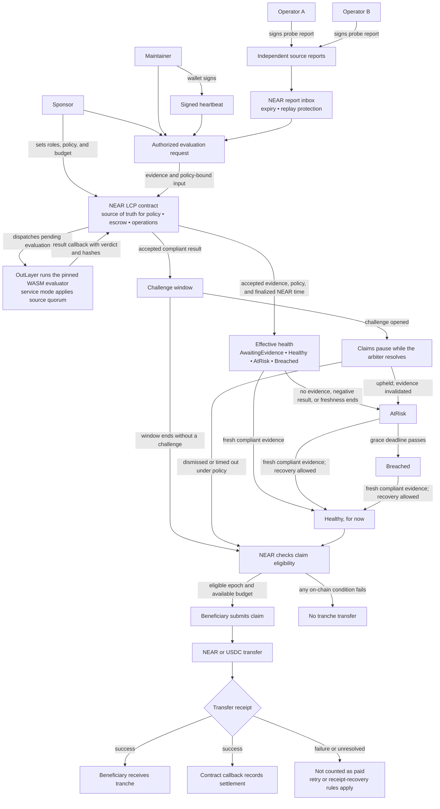

# Living Commitments Protocol

Living Commitments Protocol (LCP) is a NEAR smart contract for obligations that must remain true over time. It records evidence against a policy, derives health from evidence freshness and NEAR block time, and gates recurring budget releases on that state.

## Problem and NEAR's role

Recurring support, service agreements, and grants often depend on manual follow-up or dashboards that cannot enforce the agreed consequence. LCP makes the agreement's evidence rules and settlement conditions inspectable and enforceable on-chain. NEAR stores the commitment, policy, evidence outcomes, challenges, and escrow; NEAR time controls deadlines; and the contract authorizes payouts or refunds. The Console displays that state but does not decide eligibility or move funds by itself.

An OutLayer WASM evaluator checks submitted evidence and returns a result to the contract. Its TEE attestation can bind the evaluator code and execution inputs/outputs; it cannot prove that an external evidence source tells the truth or that evaluator logic is correct.

## Protocol flow



The evaluator reports a verdict; it does not release funds. The beneficiary must submit a claim, and the contract checks the active commitment, current epoch, evidence or preserved claim right, challenge state, and available budget. Transaction gas and storage deposits are paid in NEAR, including for USDC-funded commitments.

## Try the hosted Console

- [Open the testnet Console](https://lcp.gama.works). It is hosted on the project's custom domain and connects to **NEAR testnet**, not mainnet.
- Inspect commitment **22** to see an on-chain history with challenge invalidation and recovery. Search or enter `22`, then open its timeline and evaluation details. The live health and deadlines can change as NEAR time advances.
- Open an evaluation's NEAR transaction and OutLayer report to compare the recorded transaction, input, output, and WASM hashes. Complete TEE quote verification in OutLayer's report verifier or with `outlayer-verify`; a matching hash display alone is not a quote verification.
- To try wallet actions, connect a NEAR testnet wallet and create a test commitment. Wallet actions require testnet NEAR for gas/storage and explicit wallet approval. Do not use mainnet funds.

The [preview Console](https://preview.lcp-preview.pages.dev) is available for UI review. The hosted testnet Console is intended to remain available through **November 18, 2026**, following the hackathon guidance.

## What is implemented

- `contracts/lcp-core`: commitment policies and roles, time-based health, evaluation requests, evidence history, challenges, recovery, tranche claims, asynchronous transfer reconciliation, closure, and refunds.
- `evaluators/maintenance-heartbeat`: canonical signed heartbeat checks, including NEP-413 wallet signatures.
- `evaluators/service-availability`: HTTPS reports from distinct operators, source quorum, and a bounded on-chain report inbox with expiry, replay protection, and refundable storage.
- `contracts/bounded-payout-adapter`: pool-managed, bounded actions authorized by the core contract.
- `packages/sdk` and `apps/console`: typed NEAR calls, a wallet-based interface, commitment timelines, evaluation records, and testnet governance/adapter flows.
- `services/event-indexer`: an optional Cloudflare D1 archive for finalized LCP events. Contract state remains the source of truth for health, eligibility, and settlement.
- `services/reviewer-access`: a consent-based service for encrypted reviewer artifacts. Current-phase acceptance is owner-approved; additional RPC fault-injection and independent provider review are deferred to mainnet readiness. Private OutLayer input retrieval remains disabled pending a separately verified secret flow.

The NEP-141 USDC settlement path is included in the reproducible core deployed to testnet and surfaced by the Console. An independent source review is complete, and initial funding, resolver, storage-registration, and sponsor-refund retry checks passed on testnet. Beneficiary payout, callback stress/recovery, concurrent schedules, and independent rebuild remain open before mainnet; see [P2-ASSET-ARCHITECTURE.md](P2-ASSET-ARCHITECTURE.md) and the [audit follow-up](P2-USDC-INDEPENDENT-AUDIT-FOLLOWUP.md).

## Hackathon scope and provenance

The [Git history](https://github.com/wasabinetwork/Living-Commitments-Protocol/commits/main) in this repository begins on **November 8, 2026**, within the official November 1–14 development window, with the [initial NEAR core commit](https://github.com/wasabinetwork/Living-Commitments-Protocol/commit/5c8289aeb133931a48b6ac2e7ca840aac596d913). The repository contains no pre-window code history or other-chain deployment history. The history cannot establish whether work existed outside this repository; any such predecessor should be disclosed separately. Review the dated source changes and testnet receipts rather than treating individual building blocks as novel in isolation. See the [development after the initial commit](https://github.com/wasabinetwork/Living-Commitments-Protocol/compare/5c8289aeb133931a48b6ac2e7ca840aac596d913..main), the [PRD](Living_Commitments_Protocol_%5BLCP%5D-PRD.md), and the [technical specification](Living%20Commitments%20Protocol%20-%20Technical%20Specification.md).

Primary frameworks, protocols, and infrastructure used: Rust and `near-sdk`; NEAR testnet, JSON-RPC, and NEP-413; OutLayer; Next.js and React; `@hot-labs/near-connect`; TypeScript; Cloudflare Workers, Pages, D1, R2, and Wrangler. Exact package versions and transitive dependencies are recorded in `Cargo.lock` and `package-lock.json`. OpenAI Codex was used for development assistance. No production/mainnet deployment is claimed.

## Development

Use the pinned Rust toolchain in `rust-toolchain.toml` and Node.js 22 from `.nvmrc`.

```sh
npm ci
cargo test --workspace --locked
npm test
npm run build
```

Run the Console locally after copying `apps/console/.env.example` to `apps/console/.env.local` and setting a deployed **testnet** contract ID:

```sh
npm run dev --workspace=@lcp/console
```

Build contract and evaluator WASM with the commands in [TESTING.md](TESTING.md). The mainnet release still requires independent contract review, reproducible build verification, and an immutable account-key configuration; testnet contracts remain upgradeable.

## License

Project-authored code and documentation are licensed under [Apache-2.0](LICENSE). The upstream `NEAR-HACKATHON-SKILL.md` snapshot is excluded and remains subject to the [official hackathon guide](https://nearhackathon.com/HACKATHON.md).
